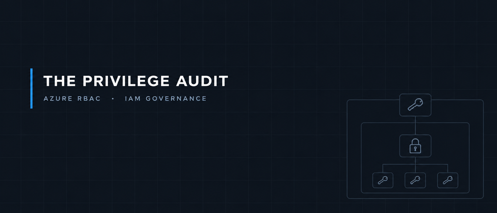

# Auditing Azure RBAC Four Ways: What Each Method Cannot See

> [!NOTE]
> Identifiers and lab answers are redacted throughout, both in the text and in screenshots. This preserves the integrity of the lab for others and follows standard practice for handling environment data.

**Date:** 2026-10-10

**Environment type:** Live multi-user Azure training tenant

**Report type:** Access audit, not incident response


---

## Scope and methodology

The board asked for a fresh review of who can do what in the tenant following an earlier incident. This is an audit rather than an investigation: the objective was to document standing and eligible access across the subscription, not to trace a specific event.

**In scope:** Azure RBAC, which governs access to deployed resources. Microsoft Entra directory roles, which govern management of the directory itself, were explicitly out of scope. The two are separate permission systems and an audit of one says nothing about the other.

**Access level:** Reader across the subscription, plus two PIM-eligible Operative roles at resource group scope. This bounded what I could see, and in two of the four methods it bounded the results themselves rather than just the breadth of them.

**Methods used, in the order they were run:**

| # | Method | Why it was next |
|---|---|---|
| 1 | Access control (IAM) blade and role assignment export | The no-tooling baseline. Needs nothing but a browser and a sign-in, so it establishes what normal looks like before anything else means something |
| 2 | Azure CLI via Cloud Shell | Same data without the portal's formatting, and scriptable, so the audit becomes repeatable rather than a one-off activity |
| 3 | Azure Resource Graph with KQL | Inverts the question from "who has access here" to "where does this principal have access", tenant-wide in one query |
| 4 | PIM export | The only method that knows about time: eligible versus active, and when an assignment ends |

A fifth stage required synthesising all four to locate an over-provisioned account with no instructions given.


## Findings

Ranked by severity. Each describes the class of finding rather than its value.

### 1. A user holding Owner directly at a resource group, constrained by an ABAC condition — High

An individual user account held Owner at a resource group scope, assigned directly rather than through a group. Every other assignment observed across the tenant was granted to a group. The assignment carried an attribute-based access control condition restricting which role definitions it could further assign or delete.

The condition is the interesting part. Attaching a constraint to an Owner grant is an implicit admission that Owner was more than the job required. The correct remediation is not a tighter condition but a narrower role.

### 2. An orphaned role assignment tied to a deleted principal — High

A role assignment at a production resource group referenced a principal of type User whose name resolved to nothing. The assignment itself was intact and active; only the account behind it was gone.

**Why this matters beyond untidiness:**

Azure stores the GUID rather than the name. What is still live here, what would happen if anything were ever recreated with that object ID, and what does the orphan tell you about the offboarding process that produced it?

### 3. Privileged access that PIM does not govern — High

Owner assignments exist at both subscription and management group scope in the role assignment export. Neither appeared in the PIM assignments view available to me at subscription scope, where the only active assignment present was Defender for Cloud Metrics.

Two readings are possible and I could not separate them with the access I held. Either those Owner grants were never enrolled in PIM, in which case the organisation's privileged access management covers less than a PIM report would suggest, or my Reader scope limits what the PIM view returns. The first is the more serious finding and the second is a real possibility given that two other methods in this audit returned access-bounded results.

Either way the practical conclusion holds: **a clean PIM report is not evidence that privileged access is governed.** It is evidence about the assignments PIM knows of. Confirming which reading applies requires an account with broader scope and is the first thing I would hand to whoever picks this up.

### 4. Standing permanent access inside PIM — Medium

The PIM active assignments view showed a long list of roles held with an end time of Permanent and a state of Assigned. Permanent and active is the opposite of what PIM exists to provide. Only one assignment in the view was in an Activated state with an expiry, and that was the role I had elevated myself.


Permanent and Assigned across the list, with a single Activated row carrying an end time

### 5. Group-based grants with no visible membership — Medium

Most access in the tenant is granted to groups. No method used in this audit showed who was inside those groups, so the exports establish that a group holds a role without establishing how many people that represents. In a tenant using dynamic membership, group membership can also change without any approval step.

### 6. The portal's rendered view disagreed with its own export — Low, but material to the method

At the hidden resource group, the Access control (IAM) role assignments table displayed "No results" while the Download role assignments button on the same blade returned a populated export including the Owner assignment above. Same account, same scope, same moment.


This is a reliability finding about the tool rather than about the tenant. An auditor who trusted the rendered view here would have reported that resource group as having no assignments.

## Methodology comparison

The artifact of this audit. No single method is complete, and the four gaps are different in kind: format, breadth, time, and coverage.

| Method | Sees | Misses |
|---|---|---|
| IAM blade / role assignment export | Every principal with access at a scope, including grants inherited from above and assignments on children | Members of groups, orphaned assignments, and one subscription at a time |
| Azure CLI | The same data unformatted, including an empty principal name where the account was deleted. Scriptable and repeatable, so the audit can be re-run and compared over time | One scope per run, so a tenant with many resource groups means many commands and many outputs to reconcile |
| Resource Graph (KQL) | Every assignment across the whole tenant in one query, with scope as an output column rather than an input | Eligible assignments, so it only ever shows standing access |
| PIM export | Assignment state, eligible versus active, with start and end times, resolved principal names, and member type distinguishing direct from inherited | Any standing assignment never enrolled in PIM, so it reports only on what it governs |

**Commands used** (safe to publish, and the useful part of this audit to reuse):

```bash
az role assignment list --resource-group <resource-group-name>
```

```kusto
authorizationresources
| where type =~ 'microsoft.authorization/roleassignments'
| extend principalId = tostring(properties.principalId)
| extend description = properties.description
| where principalId == '<orphaned principal ID>'
| project name, principalId, principalType = properties.principalType, scope = properties.scope, description
```

## What broke / what surprised me

- **Name resolution behaved differently across tools with the same account.** The CLI and Resource Graph both failed to resolve principal names, and the Resource Graph query filtered on a principal ID returned nothing at all. PIM resolved names without difficulty. Nothing about my role assignments changed between those runs. The lesson I took is that a tool returning an empty result is telling you something about the tool and your access, not proving the thing is absent.

- **My blind spots were not all tool limitations.** Two of the four methods were bounded by what my Reader scope could resolve rather than by any documented gap in the method. An auditor with broader access would produce a different table from the same four tools.

- **I could not export at subscription scope**, which pushed me back to the portal for part of the work. An auditor works with the access they have, and sometimes the lowest-tech method is the only one available.

- **The over-provisioned account was listed in PIM the whole time.** I activated one of my two eligible roles, then spent considerable effort looking for a hidden scope in exports and resource group listings. The second eligible assignment named the resource group directly, on the screen I had already been looking at. I treated activation as a single action instead of first reading what else I was eligible for.

- **A failed activation attempt** sat in my PIM audit history between the successful one and the correct one, which is itself a record of the wrong turn.

## Recommendations

Ordered by sequence of execution rather than severity alone.

| # | Action | Priority | Owner |
|---|---|---|---|
| 1 | Revoke the orphaned role assignment tied to the deleted principal | High | IAM |
| 2 | Replace the direct Owner grant at resource group scope with the narrowest job-function role at the narrowest scope that supports the work, rather than retaining Owner with a condition attached | High | IAM |
| 3 | Review the offboarding process that left an assignment behind, since one orphan implies the process does not revoke access on account deletion | High | IAM / HR systems |
| 4 | Establish whether the Owner grants at subscription and management group scope are enrolled in PIM at all, then move them to PIM eligible with MFA, justification and time limits | High | IAM |
| 5 | Assign roles to groups rather than to individual users, and audit group membership with the same rigour as the role assignments themselves | Medium | IAM |
| 6 | Run this audit on a quarterly cadence and treat the output as a ticket queue, so findings are worked rather than filed | Medium | IAM / Governance |

One cost worth stating. Moving standing Owner access to PIM eligible adds friction to work that is currently instant, and it needs an approver who is reliably available, or the first incident at 3am becomes an access problem on top of an incident.

## What I learned

- The four methods answer four different questions, not the same question with varying quality. Who has access here, the same as raw repeatable data, where does this principal have access tenant-wide, and who could have access and for how long. Knowing which question you are asking decides which tool you reach for.
- An orphaned assignment is a process finding before it is an access finding. The assignment can be revoked in seconds; the offboarding gap that produced it will produce another one next month.
- Next time I would read everything I am eligible for before activating anything. I activated one role and started hunting through exports for a scope that PIM was already listing on the same screen, because I treated activation as a single action rather than a menu to read first.
