# Reviewing a Friday Deploy Against a Production Baseline

> [!NOTE]
> Identifiers and lab answers are redacted throughout, both in the text and in screenshots. This preserves the integrity of the lab for others and follows standard practice for handling environment data.

**Date:** 2026-10-16

**Environment type:** Live multi-user Azure training tenant

**Report type:** Pre-production deploy review, not incident response

**Verdict:** Promotion to production **blocked**

---

## Executive summary

The new notification service has four problems, but only one is urgent. Internal notes are sitting on the public internet, readable right now by anyone with the link, and they point to where a password is kept. We close that today, along with a quick fix that stops strangers reaching the service. The other two need code changes, so they go into next week's work, and the service stays out of production until they're done.

---

## The Call

Four findings. Exactly one is an active exposure rather than a hygiene gap. Data readable on the public internet right now is worse than any best practice that hasn't been followed yet.

The rule I used: **exposure beats hygiene, active beats potential.** Where two fixes carry similar risk, the cheaper one goes first.

| Priority | Finding | When | Why |
|---|---|---|---|
| 1 | The Leak: public storage container | Today | Not a risk, an event already happening. Anyone with the link can read it now. |
| 2 | The Door: no inbound restrictions | Today | Nothing routes to the service yet, so it isn't urgent on risk alone. But the fix is one rule, no code, no redeploy. Zero cost means no reason to wait. |
| 3 | The Who: no managed identity | This sprint | A design flaw. Fixing it needs a code change and a role assignment, so it gets a ticket. |
| 4 | The Where: wrong region | Next deploy | Costs money and carries a compliance risk every day, but nothing is being exposed. Fixing it means a full redeploy. |

---

## Scope and methodology

A new notification service was deployed late on a Friday afternoon into a lab resource group, with no review and no deployment notes left for the reviewer. The only assurance given was that "it works." Before promotion to production, I reviewed it as the reviewing engineer.

**Access level:** Reader on the lab resource group. I could inspect every configuration but change nothing, so every finding below is an observation backed by evidence, not a fix.

**Method:** There was no written standard to review against. Instead, I used the existing production service in the shared resource group as the baseline, on the basis that a system already running healthily in production shows what "correct" looks like in this environment. For each area of the new deployment, I checked how production handled the same thing. Every finding came from a difference between the two.

The review followed five questions:

| # | Question | What it checks |
|---|---|---|
| 1 | The Where | Is it in the right place? |
| 2 | The Who | How does it authenticate to what it depends on? |
| 3 | The Leak | Where does its data actually sit? |
| 4 | The Door | Who can reach it? |
| 5 | The Call | What gets fixed first? |

---

## Findings

### 1. The Where: deployed outside the platform's region

**Observed.** The new service and its storage account were deployed to a region on another continent, in a different country from the rest of the platform. The production service, and almost every other resource group visible in the subscription, sits in a single US region.

**Verified.** Compared the Location field on both services' Overview blades, then cross-checked the Location column across all resource groups in the subscription.

**Why it matters.** The new service's own app and storage sit together, so they don't pay a cross-region cost to each other. The cost lands on every call the service makes to the rest of the platform: latency on the way there, and an egress charge on the way back, because Azure bills for data leaving a region, not entering it. The bigger issue is data sovereignty. Data stored in another country falls under that country's laws, and placing it there can break commitments the business has made about where its data lives, without anyone ever deciding to.

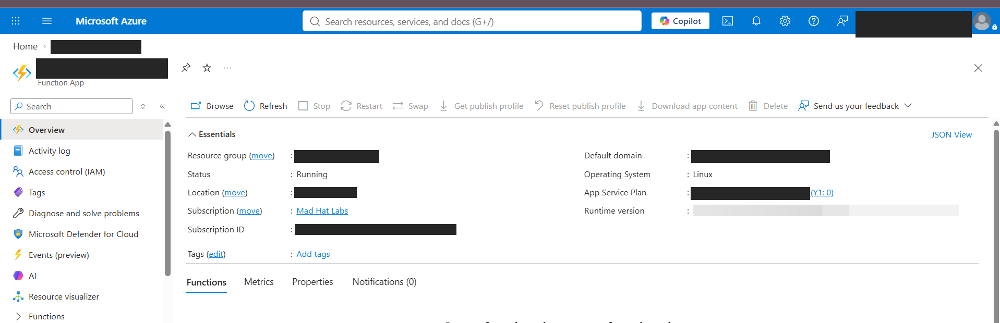

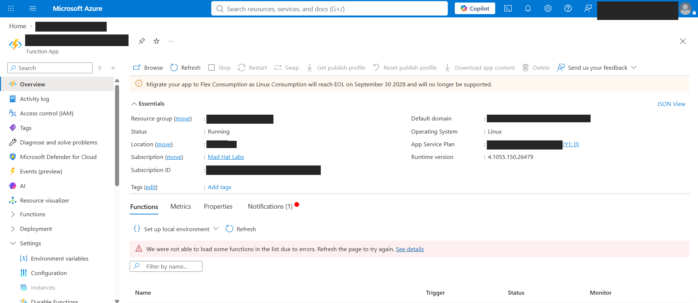
*New service (top) and production baseline (bottom). Location and plan values redacted.*

**Fix.** Redeploy into the platform's standard region. A Function App can't be moved between regions in place, so this is a redeploy, not a setting change.

### 2. The Who: no managed identity

**Observed.** No managed identity of either type is attached. Production uses a user-assigned managed identity.

**Verified.** Checked both the System assigned and User assigned tabs on the Identity blade of both services. Reader access could not read the new service's app settings, so I couldn't view the credential directly. Two independent pieces of evidence confirm a stored credential is in use:

1. The Functions runtime's own containers in the storage account show the service is actively using that storage. With no managed identity attached, the only way it can authenticate is with a stored key or connection string.
2. The deployment notes found during Finding 3 state that the connection string was shared in a Teams direct message.

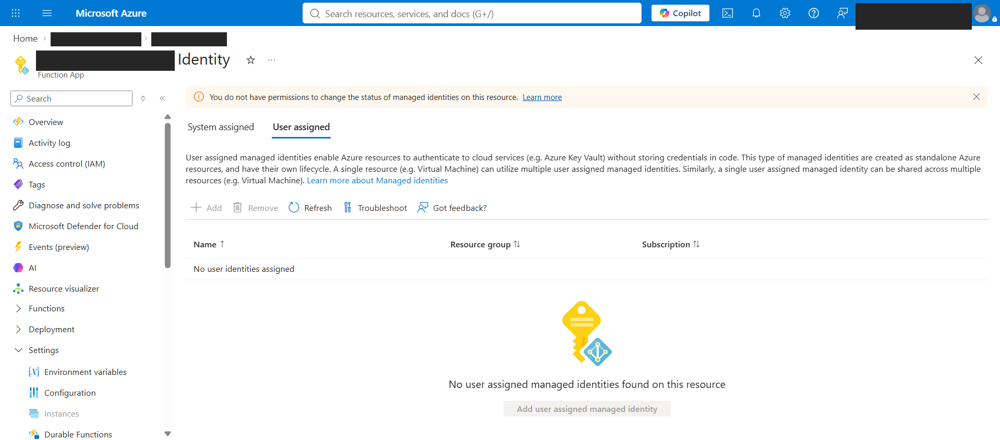

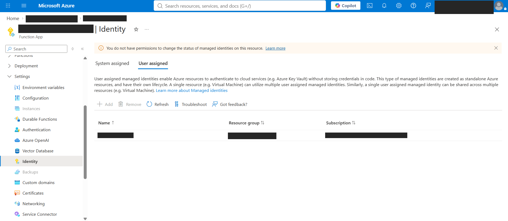
*New service with no identity attached (top). Production with a user-assigned identity (bottom).*

**Why it matters.** A stored credential works from anywhere, doesn't expire unless someone rotates it, and can be copied. This one already has been: it now also sits in a chat, outside any vault, where anyone who gets into either account can read it.

**Fix.** Attach a user-assigned managed identity, matching production, with a role scoped to that one storage account. Remove the stored credential from the app settings, then rotate the storage account key, since a copy of the old one lives in chat history.

### 3. The Leak: a storage container open to anonymous access

**Observed.** One storage container had its anonymous access level set to Blob. Every other container in the account was Private.

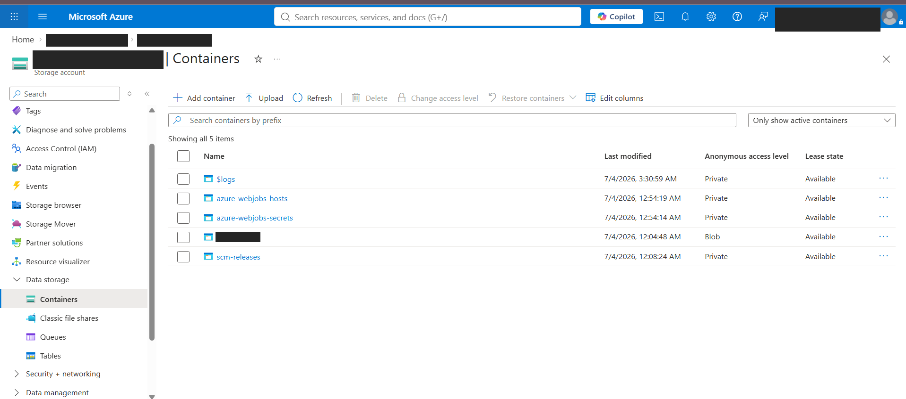
*One container set to Blob while every other container is Private.*

**Verified.** Opened the file inside the container, copied its URL from the properties page, and pasted it into a private browser window with no account signed in. The file loaded with no account, no token, and no sign-in. That moved this finding from "misconfigured" to "exposed."

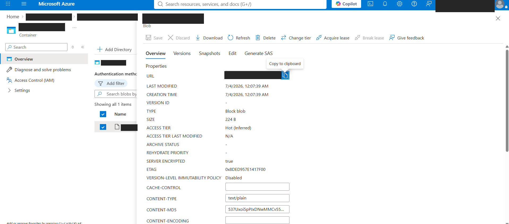

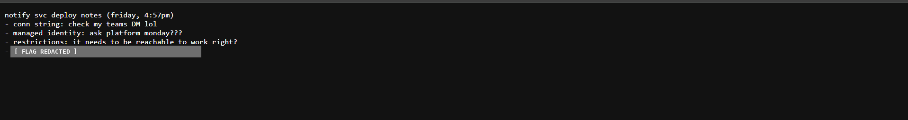
*The file's URL copied from its properties page (top), then loaded in a signed-out private window (bottom).*

**Why it matters.** Blob level means visitors can't list what's in the container, but anyone with a file's URL can read it. That URL is built from the account, container, and file names, so it can be guessed or found, not only shared.

The contents make it worse. The file holds the intern's deployment notes. Read as an attacker, they confirm the service has no managed identity, confirm it has no inbound restrictions, and say exactly where the connection string is kept: in a specific person's Teams messages. The leaked file is a map to the next attack, and that person's account becomes the obvious phishing target.

**Fix.** Set the container to Private today. Turn off anonymous blob access at the storage account level so it can't be switched back on per container. Check the storage access logs for anonymous reads of the file since deployment, because "nobody has read it" is a claim that needs evidence too.

### 4. The Door: no inbound access restrictions

**Observed.** Public network access is enabled with no access restrictions. The only rule is Allow all from any source, and the unmatched rule action is Allow. The advanced tool site (the admin console) has the same open configuration. Production has an explicit deny-all rule covering every address, with the unmatched rule action also set to Deny.

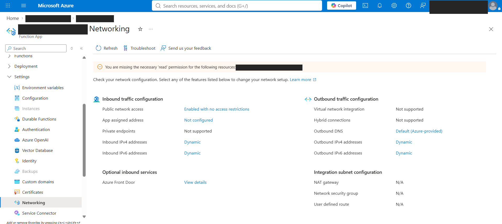

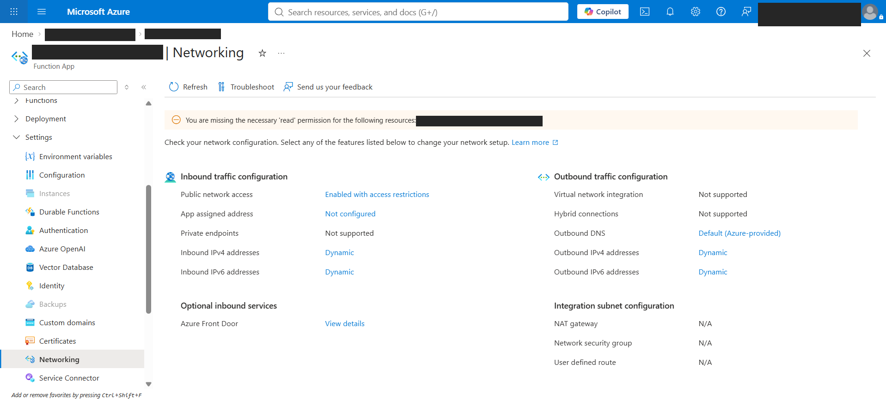
*"Enabled with no access restrictions" on the new service (top) against "Enabled with access restrictions" on production (bottom).*

**Verified.** Networking, then Access restrictions, on both services, checking both the Main site and Advanced tool site tabs.

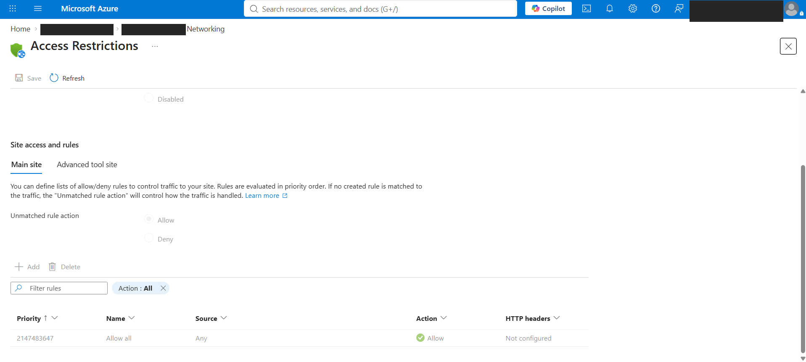

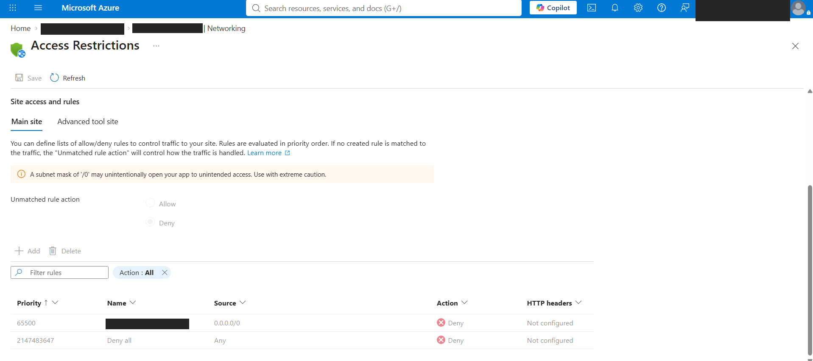
*New service: Allow all, unmatched action Allow (top). Production: explicit deny-all rule, unmatched action Deny (bottom). Rule name redacted.*

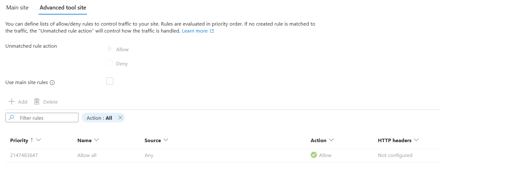
*The new service's admin console (advanced tool site), also open to any source.*

**Why it matters.** The deployment notes assume the service "needs to be reachable to work." It doesn't. Access restrictions only control traffic coming in from outside. Timer, queue, and blob triggers don't depend on inbound traffic: a timer fires on a schedule inside Azure, and a queue trigger has the runtime reach out to check for messages. Production proves the point by running with all inbound traffic denied, most likely on non-HTTP triggers. Right now the new service is an open endpoint anyone on the internet can probe.

**Fix.** Add a deny-all rule matching production's baseline and set the unmatched rule action to Deny. Set the advanced tool site to use the main site rules. If the service ever genuinely needs an HTTP trigger, allow only the specific caller, never the whole internet.

### Observation outside scope: production's admin console

While checking the advanced tool site on production for comparison, I found it configured the same way as the new service: Allow all from any source, unmatched action Allow, not using the main site rules. Production locked its front door and left the admin console reachable from the internet.

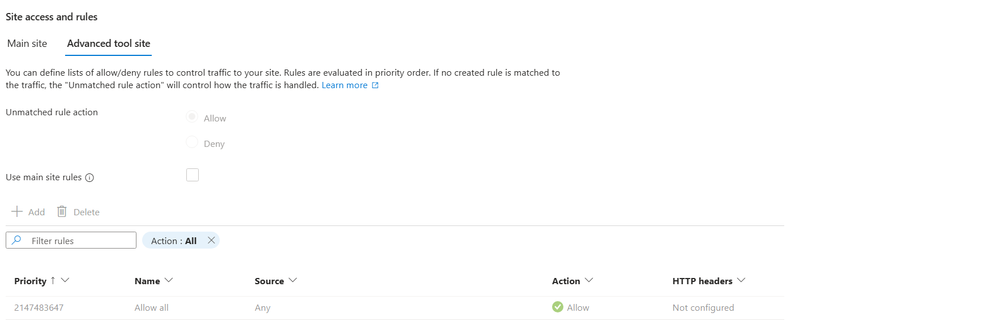
*Production's admin console: Allow all, unmatched action Allow, not using the main site rules.*

The admin console still requires authentication, so this isn't anonymous access. What's exposed is the login surface itself, so anyone anywhere can attempt it. This sits outside the ticket, which covered the new service only, so it is flagged here for the platform team rather than treated as a finding.

---

## What broke / what surprised me

The review itself was straightforward, and the baseline did most of the heavy lifting. Two moments made me slow down. Reader access couldn't read the app settings, so one finding had to be built from indirect evidence rather than seen directly. And the answer key had a gap of its own: comparing against production only works if you remember production can be wrong too.

---

## Recommendations

Ordered by sequence of execution.

| # | Action | Priority | Owner |
|---|---|---|---|
| 1 | Set the public container to Private, disable anonymous blob access at the storage account level, and review storage access logs for anonymous reads since deployment | Critical | Service owner |
| 2 | Add a deny-all inbound rule, set the unmatched action to Deny, and apply the same rules to the admin console | High | Service owner |
| 3 | Attach a user-assigned managed identity with a scoped role on the storage account, remove the stored credential, and rotate the storage key | High | Service owner / Platform |
| 4 | Redeploy into the platform's standard region | Medium | Service owner |
| 5 | Add a pre-deploy checklist covering these four checks, so the next Friday afternoon doesn't need a human reviewer to catch them | Medium | Platform |
| 6 | Review the advanced tool site restrictions on production (outside scope) | Medium | Platform |

---

## What I learned

- A function doesn't need to be reachable to work. Only HTTP triggers depend on inbound traffic. Timer, queue, and blob triggers fire from inside Azure, and production running with every inbound request denied proved it.
- Priority isn't only about risk. When a fix costs nothing, it goes now, even if the risk it closes is lower.
- Region is a compliance decision before it's a performance one. Latency and egress are costs. Data sovereignty is a commitment.
