# Tracing Private Storage Traffic Past a Forced Tunnel

> [!NOTE]
> Identifiers and lab answers are redacted throughout, both in the text and in screenshots. This preserves the integrity of the lab for others and follows standard practice for handling environment data.

**Date:** 2026-10-23

**Environment type:** Live multi-user Azure training tenant

**Report type:** Network trace, written as a reply to a ticket

**Access:** Reader on the lab resource group

---

## The ticket

> "Our new service can reach the customer-data storage account, but I don't understand why or how. Can someone walk me through the network path?"

---

## The answer

Here's why it works. When your service asks for the storage account by its normal name, public DNS redirects it to a private version of that name, and the private DNS zone linked to our VNet answers with a private address. That address belongs to the storage account's private endpoint, which sits in the same subnet your service runs in. Because the destination is inside our own network, the subnet's NSG lets the traffic out under the default rule that allows traffic within the VNet. The subnet does have a route forcing all traffic to a firewall appliance, but Azure always uses the most specific route it has, and the routes for our own network and for the endpoint beat that catch-all, so the storage traffic goes straight to the endpoint and never touches the appliance. The storage account itself has public access disabled, so this private path is the only way in. Anyone outside a linked network who looks up the same name gets the public address instead, and is refused.

---

## The path

The order the traffic actually moves in. DNS was checked last in the trace, but it happens first, and it is a lookup, not a stop for the data.

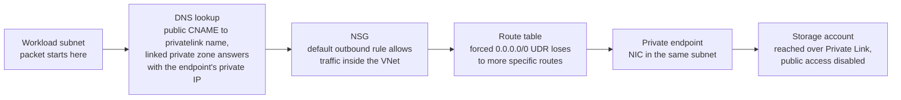

**At the route table:** the private endpoint's /32 system route outranks the 0.0.0.0/0 UDR.

---

## The trace

### 1. The VNet

**Checked.** The VNet's address space and its Subnets blade, then Connected devices.

**Found.** Two subnets: a workload subnet and an appliance subnet. Only the workload subnet had an NSG and a route table attached. The Available IPs column showed the appliance subnet had no addresses in use, and the workload subnet had exactly one. Connected devices showed that one address belonged to the storage account's private endpoint, not to a workload VM.

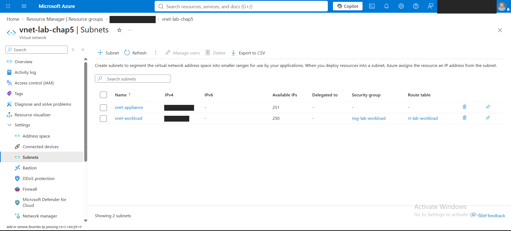
*Two subnets. Only the workload subnet has an NSG and route table, and the appliance subnet has no addresses in use.*

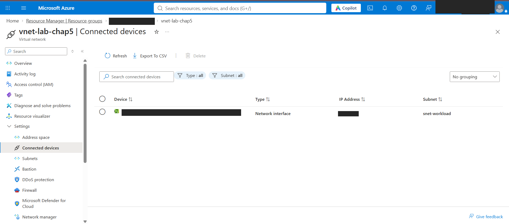
*The one address in use in the workload subnet belongs to the private endpoint.*

**What it means.** The traffic starts in the workload subnet. No workload VM was deployed, so the path was traced from configuration rather than from a running machine.

### 2. The NSG

**Checked.** Inbound and outbound rules on the workload subnet's NSG, and where it is associated.

**Found.** The NSG is attached at the subnet level, not to individual NICs. Inbound has two custom rules: an allow for HTTPS from a single address named as the VPN, and a deny for all traffic from the internet. That deny is redundant in outcome, because the default DenyAllInBound would block the same traffic, but while it exists it is the rule that matches internet traffic, so its name is what appears in the logs. Outbound has only the default rules.

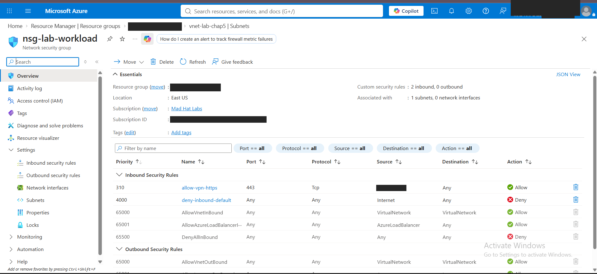
*Two custom inbound rules, attached to one subnet and no NICs.*

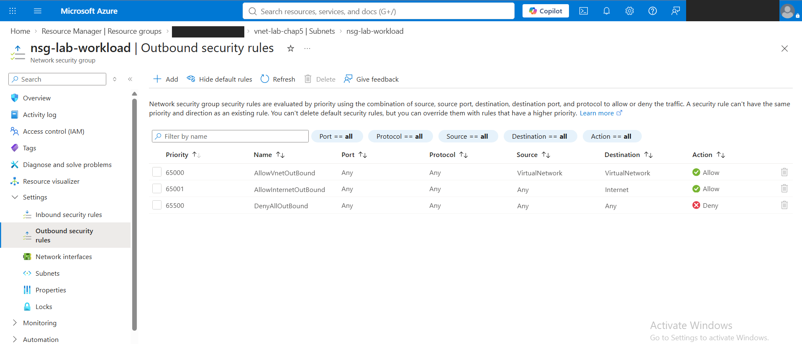
*Outbound has only the default rules.*

**What it means.** The storage traffic matches the default AllowVnetOutBound rule, because its destination is inside the VNet's address space. The NSG allows the traffic, but it is not what makes the path private: traffic to the public endpoint would be allowed just as easily, by AllowInternetOutBound.

### 3. The route

**Checked.** The route table's routes and its subnet association.

**Found.** One user defined route sends all traffic (0.0.0.0/0) to a virtual appliance. The appliance's address falls inside the appliance subnet, which hop 1 showed has nothing deployed in it.

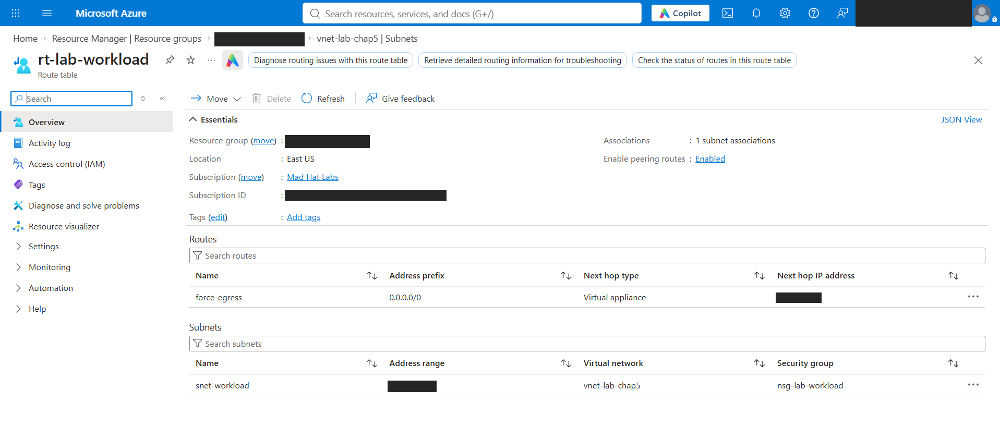
*One UDR sending 0.0.0.0/0 to a virtual appliance, attached to the workload subnet.*

**What it means.** Internet-bound traffic is sent to an empty address and dropped. The storage traffic never takes that route at all. Its destination is inside the VNet's own address space, and Azure picks routes by longest prefix match, so a more specific route wins: the VNet's own system route and the private endpoint's /32 route. Both of those are documented Azure default behaviour. With no VM in the subnet, there was no machine to display Effective routes on, so the winning route is shown by the destination's address rather than by the routing table itself.

### 4. The private endpoint

**Checked.** The private endpoint's Overview and DNS configuration, then the storage account's private endpoint connections and Public access settings.

**Found.** The endpoint connects to the storage account's blob service, and its NIC has a private address inside the workload subnet. On the storage side, the connection is Approved, and marked Auto-Approved, meaning it was created by someone who already had rights over the storage account rather than requested from outside. Public network access on the storage account is Disabled, and its network rules are marked as not in effect.

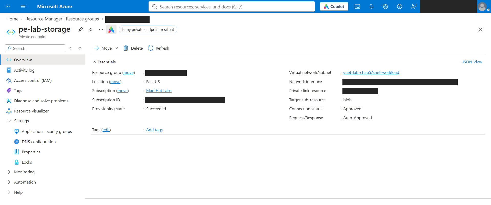
*Blob sub-resource, in the workload subnet, Approved and Auto-Approved.*

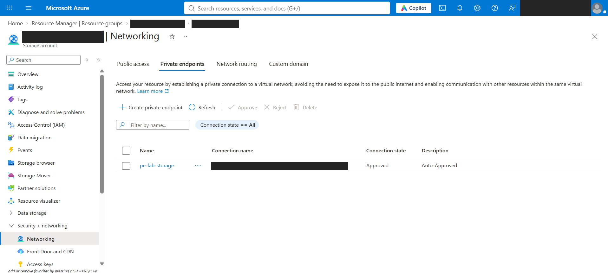
*The same connection, seen from the storage account side.*

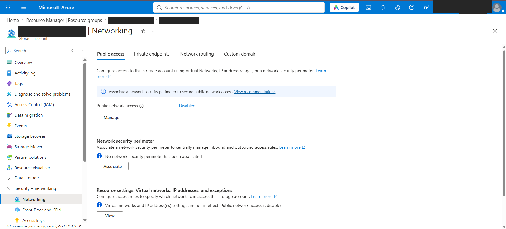
*Public network access Disabled, and network rules not in effect.*

**What it means.** The endpoint is the only way into the storage account, and it sits in the same subnet as the workload. The traffic never leaves the subnet to reach it, and from the endpoint it travels over Private Link on Microsoft's backbone, never the internet.

### 5. The name

**Checked.** The private DNS zone's record sets and its virtual network links.

**Found.** A private DNS zone for blob private endpoints, holding an A record for the storage account that points at the endpoint's private address. The zone is linked to the workload VNet.

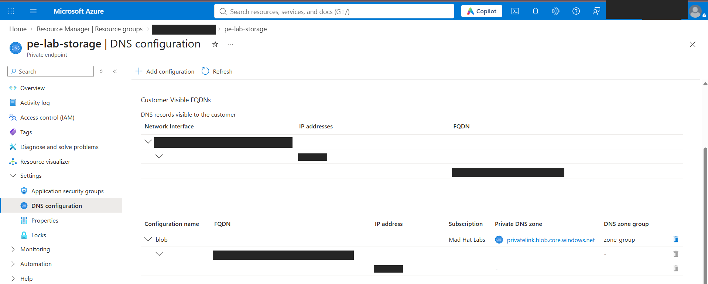
*The public name and its privatelink name, both resolving to the endpoint's address.*

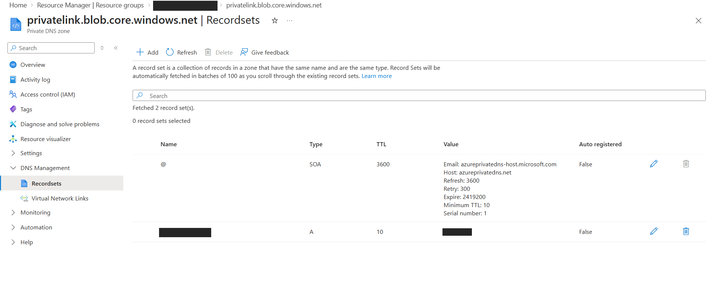
*The A record in the private zone that answers the lookup.*

**What it means.** The app asks for the storage account by its normal name. Public DNS replies with a CNAME to the privatelink version of that name, and because the VNet is linked to the private zone that owns the privatelink name, the zone's A record answers with the private address. This lookup happens before the packet is ever sent. Without the link, the VNet would receive the public address, and the connection would hit disabled public access. Anyone outside a linked network gets exactly that result.

---

## What I would flag

- **Storage traffic bypasses inspection entirely.** The path is private, so this is a visibility gap, not an exposure: the firewall never inspects or logs traffic to an account holding customer data. Is the network team aware, and is that intended? If inspection is required, the endpoint's traffic would need its own route through the firewall.
- **The forced route points at an appliance that does not exist.** Internet-bound traffic from the workload subnet is dropped. That fails closed rather than open, but anyone who believes a firewall is inspecting this subnet's internet traffic is wrong. Either the appliance was never deployed or it has been removed.

---

## What broke / what surprised me

I assumed the NSG's VirtualNetwork allow rule would carry a packet through to the appliance address. In permission terms it would. But permission isn't delivery, and nothing existed at that address to receive it. Separating "is it allowed", "where does it go" and "is anything there" was the biggest correction of the lab.

The only device in the workload subnet was the private endpoint itself. There was no workload VM, which meant there was nothing to show Effective routes on, and the routing conclusion had to rest on the destination's address and documented Azure behaviour instead.

---

## What I learned

- A route that matches isn't a route that wins. 0.0.0.0/0 matches every destination, but it only wins when nothing more specific exists.
- An NSG decides whether traffic is allowed, and a route decides where it goes. Neither guarantees anything is there to receive it.
- DNS is checked last in a trace like this, but it happens first. When a private endpoint fails, it is usually a wrong address, not a wrong location.
