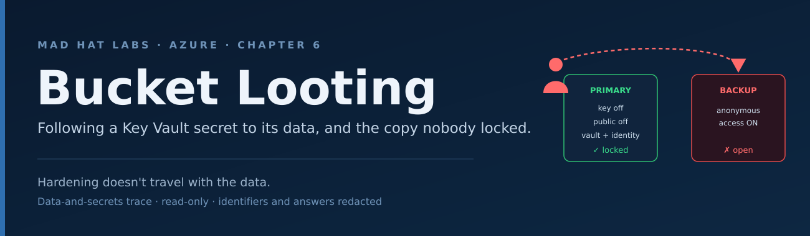

# Bucket Looting

> [!NOTE]
> Identifiers and lab answers are redacted throughout, both in the text and in screenshots. This preserves the integrity of the lab for others and follows standard practice for handling environment data.

**Date:** 2026-11-09

**Investigation:** Bucket Looting (Chapter 6)

**Environment type:** Live multi-user Azure training tenant

**Report type:** Data-and-secrets trace, written as a reply to a ticket

**Access:** Reader on `rg-madhat-lab-chap6`, Key Vault Secrets User on `kv-madhat-lab-chap6`

---

## The ticket

> "Our service reads a database connection string from Key Vault at startup, but we've never traced what's on the other end. What is the app actually touching, how is it reachable, and is any of it exposed on the public internet?"

---

## The answer

The connection string in Key Vault points at one storage account, and that account is locked down properly. The account key is turned off, so the only way in is identity. The public door is closed, so it is only reachable over a private connection inside the network. The app reads the secret with its own managed identity instead of a stored password. So the resource the ticket asked about is not exposed.

But the same customer data exists in a second storage account in the same resource group, and that one has anonymous access switched on. Anyone on the internet can read it with no login at all.

The thing the app touches is safe. A forgotten copy of the same data is wide open.

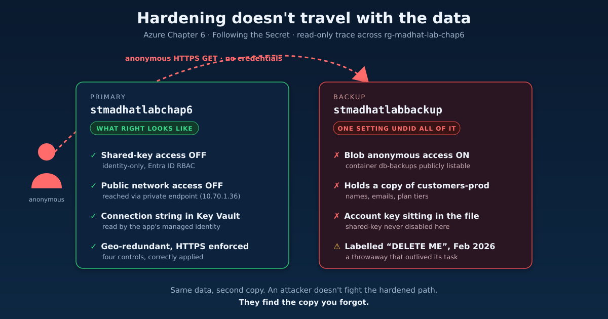

---

## The path

The order the trace runs in, data first and the forgotten copy last.

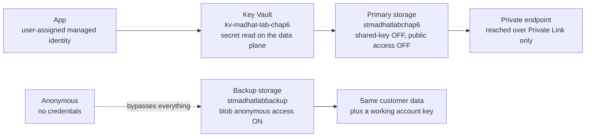

---

## The trace

### 1. The data

**Checked.** The resource group's resources, then the Overview and redundancy of the account the app points at.

**Found.** Two storage accounts in the group. The app's account, `stmadhatlabchap6`, is StorageV2, Standard, Hot tier, geo-redundant (primary Central US, secondary East US 2), with secure transfer required.

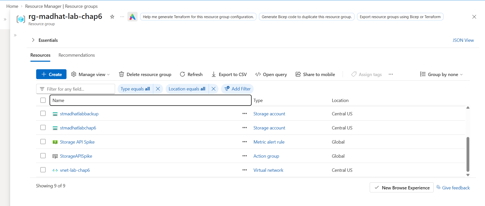
*Two storage accounts sit in the same resource group. The app points at one of them.*

**What it means.** The data lives in one account and is replicated to a second region. Data existing in more than one place is the whole story of this lab.

### 2. The key posture

**Checked.** The account's Configuration blade, then the app identity's role assignment.

**Found.** Allow storage account key access is Disabled, and blob anonymous access is Disabled. The app's user-assigned identity `id-lab-app-chap6` holds Storage Blob Data Contributor on the account.

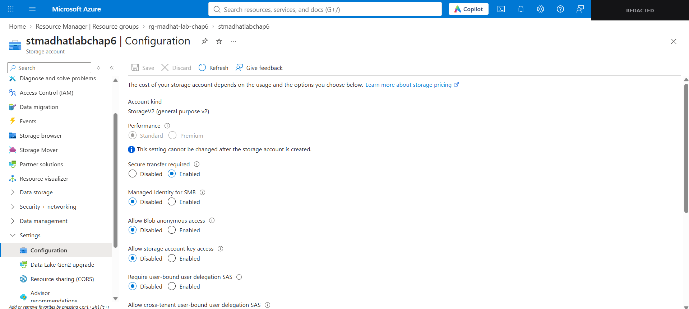
*Shared-key access off and anonymous access off. Identity is the only way in.*

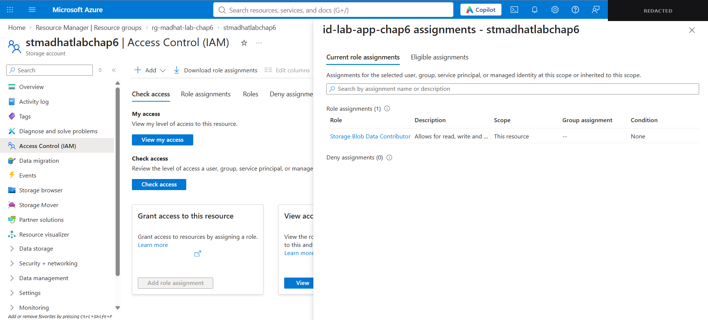
*The app identity has Contributor (read, write, delete) where a read path would only need Reader.*

**What it means.** Shared key is off, so identity is the only path in. One catch on the way past: the app reads a connection string, but Contributor gives it write and delete too. That is broader than a read path needs, and worth noting even though it is not the headline finding.

### 3. The network

**Checked.** The account's Networking blade, its public access setting, and the private endpoint's DNS.

**Found.** Public network access is Disabled. A private endpoint `pe-lab-storage` is attached and Approved, its NIC has a private IP (`10.70.1.36`), and the blob FQDN resolves to that private address through private DNS.

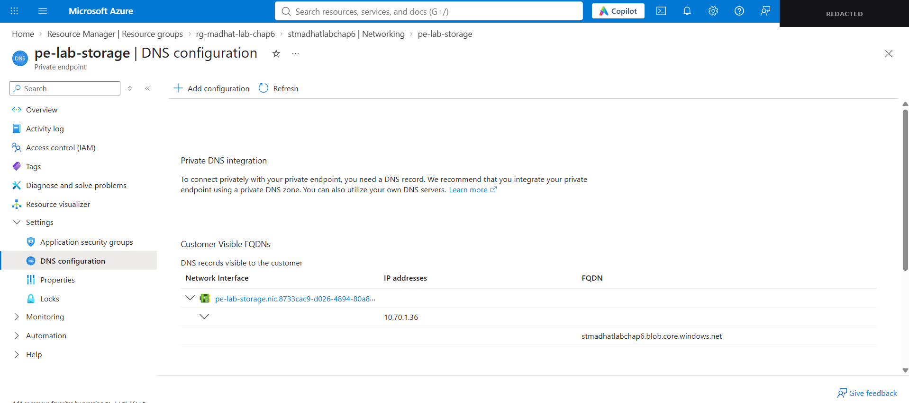
*The public blob name resolves to a private IP inside the VNet. Traffic never touches the public internet.*

**What it means.** The public door is closed. The app reaches the data over Private Link inside the VNet, and the internet cannot.

### 4. The secret

**Checked.** The vault's secrets, then the value of `app-db-connection` on the data plane.

**Found.** Two secrets, `app-db-connection` and `trace-signoff`. Reading the value needed Key Vault Secrets User. Reader alone shows the secret exists and keeps the value hidden.

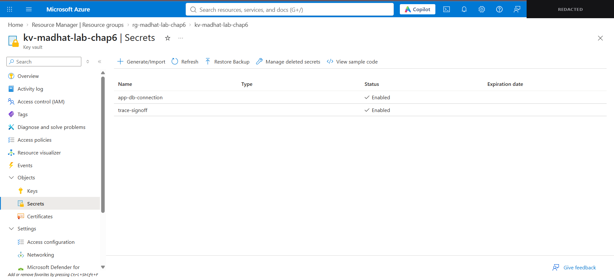
*The vault holds the secret. Reading its value is a data-plane action, which is why Reader alone would not have been enough.*

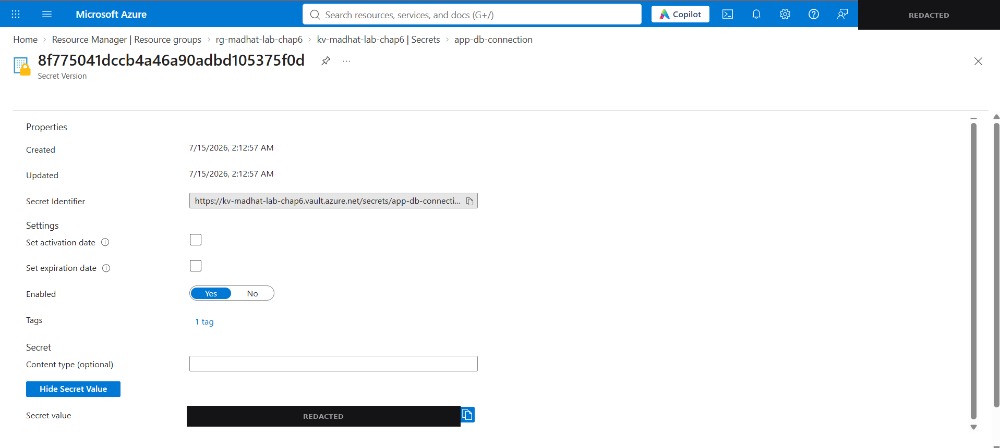
*Show Secret Value reveals it in the portal. The value is covered. The point is that the data-plane role let me read it at all.*

**What it means.** The secret is held in a vault and read by the app's managed identity, not stored in a config file. This is the secure pattern, and it is exactly the pattern the second account ignored.

### 5. The copy

**Checked.** The second account, `stmadhatlabbackup`: its anonymous-access setting, then the public container.

**Found.** Allow blob anonymous access is Enabled. The container `db-backups` lists and serves its contents with no credentials. A plain web request returned an anonymous listing:

```
GET https://stmadhatlabbackup.blob.core.windows.net/db-backups?restype=container&comp=list
```

In plain terms, I put a web address in the bar and the storage account handed back a full list of what was inside, no login, no questions asked. One object: `customers-export-2026.json`, 822 bytes, holding a copy of production customer data.

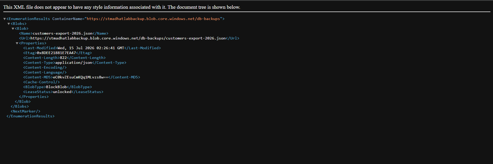
*No login prompt. The container lists its contents to anyone who asks.*

What was in the file made the point louder than the lab needed to:

- An export note reading *"temp copy for migration test - DELETE ME (ticket DATA-1288)"*
- `source_database`: `customers-prod`
- `exported_by`: `quick-export.ps1`, dated February 2026
- A connection string for the backup account with an embedded account key
- Four customer records (name, email, plan tier)

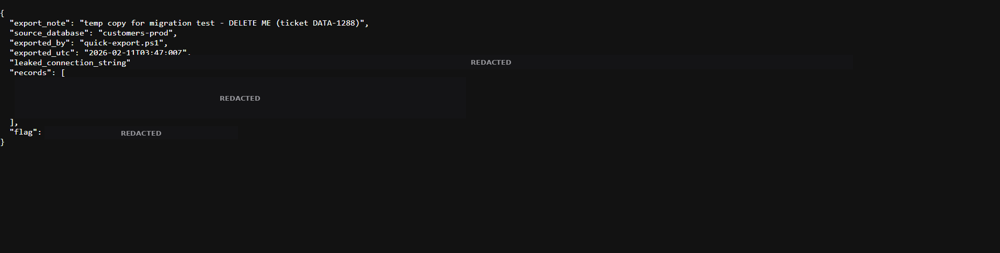
*The export note, source database, and timestamp are left visible. The connection string value, the records, and the flag are covered.*

**What it means.** Shared key is still enabled on this account, and its key is sitting in a world-readable file. So even the identity-only posture confirmed on the primary is undone, because a usable key to a different account is published to the internet. And the file is a throwaway from February, explicitly marked for deletion, still live nine months later.

---

## The lesson

Hardening is not a property of a control you switched on. It is a property of every place the data lives.

Every control from this chapter was applied correctly to the primary account, and none of them mattered, because the same data also sat somewhere those controls were not. The attacker never fights the hardened path. They look for the copy you forgot.

---

## Why it happens

Someone needed a quick copy of the data for a migration test. The secure path was slower, so they ran a throwaway export and moved on. The task finished. The copy did not get cleaned up. Nine months later it is still there, still public, still holding production records and a working key.

That is not a hypothetical. Temporary and overlooked configurations that were meant to be torn down are the root cause behind a large share of real cloud data exposures. The hardened account is almost never where the breach starts.

One nuance worth saying plainly. This resource group does have monitoring: a metric alert `Storage API Spike` wired to an action group. But that watches request volume, not posture. Monitoring existed. It just was not watching for the thing that actually mattered.

---

## What I would flag

- **The anonymous backup is the active exposure.** Set Allow blob anonymous access to Disabled on `stmadhatlabbackup`. Off at the account level, it overrides any container ACL, so one setting closes the whole thing.
- **A working account key is published in a public file.** Rotate the backup account's key now, disable shared-key access, and move it to identity like the primary.
- **The throwaway should not exist.** It was marked for deletion in February under ticket DATA-1288. Delete it.
- **The app identity is over-privileged.** Storage Blob Data Contributor where Storage Blob Data Reader would do, if the service only reads.
- **Catch the next one at creation, not after.** The built-in Azure Policy "Storage account public access should be disallowed", set to Deny, stops a public account being created at all. Microsoft Defender for Storage alerts on anonymous reads. A scheduled Azure Resource Graph sweep for accounts with blob public access enabled surfaces a new one the day it appears. When one is flagged, the storage account's Activity Log write event gives the who and when, which is the exposure window.

---

## What I learned

- Anyone can confirm the account named in the ticket is locked down. The skill that protects an organisation is asking the question the ticket did not: is this the only place the data lives?
- Recognising a correct configuration is half the job. The other half is not stopping there.
- A control is only as strong as the weakest copy of what it protects. Shared key off on one account means nothing if a working key to another is sitting in a public file.
